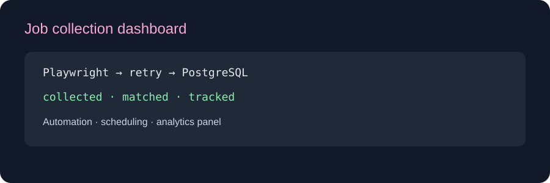

# Etsy Data Pipeline

[English](README.md) | [Türkçe](README_TR.md) | [Deutsch](README_DE.md)



## Purpose

The collector flow is Playwright‑ready: collect listings, retry transient failures, persist records and inspect matching/status analytics in the dashboard.  
A production‑style browser automation and data engineering project built from the original Etsy collection concept. It runs scheduled Playwright collection jobs, retries transient failures, upserts normalized listing data into PostgreSQL, keeps price observations, and presents a compact analytics dashboard.

## Features

- Async Playwright collector with resilient locators  
- Exponential retry with a three‑attempt limit  
- APScheduler interval jobs with concurrency protection  
- PostgreSQL listings, pipeline runs, and price observations  
- Idempotent listing upserts by canonical source URL  
- Allowed‑host validation and configurable collection limits  
- Offline demo mode with deterministic sample data  
- REST API and responsive analytics dashboard  
- Docker Compose, tests, Ruff, and GitHub Actions CI  

## Stack

- Python  
- Playwright  
- APScheduler  
- PostgreSQL  
- Docker & Docker Compose  
- Ruff (linting/formatting)  
- pytest  
- GitHub Actions CI  

## Setup & Usage

### Docker

```bash
cp .env.example .env
docker compose up --build
```

Open:

- Dashboard: http://localhost:8002  
- Swagger UI: http://localhost:8002/docs  
- Health check: http://localhost:8002/health  

The default `COLLECTOR_MODE=demo` works offline. Click **Run pipeline now** to insert sample records and populate the dashboard.

### Authorized Playwright mode

Update `.env` after confirming you are allowed to collect the target:

```env
COLLECTOR_MODE=playwright
TARGET_URL=https://www.etsy.com/your-authorized-page
ALLOWED_HOSTS=["www.etsy.com","etsy.com"]
SCHEDULE_HOURS=6
```

The DOM extraction logic is isolated in `PlaywrightCollector`, making selector updates straightforward when the permitted target changes.

### Local development

```bash
python -m venv .venv
pip install -e ".[dev]"
python -m playwright install chromium
cp .env.example .env
uvicorn app.main:app --reload --port 8002
```

When running the API outside Docker, set the database host to `localhost` and port to `5434`.

## Testing

```bash
ruff check .
ruff format --check .
pytest -q
```

## Limitations & Responsible Use

- Use Playwright mode only on pages you own or are authorized to automate.  
- Review the target site's terms of service, robots.txt, API availability, rate limits, copyright, and privacy requirements.  
- Prefer an official API when one is available.  
- The project does not bypass authentication, CAPTCHAs, access controls, or anti‑bot protections.  

## License

See the `LICENSE` file for details.
